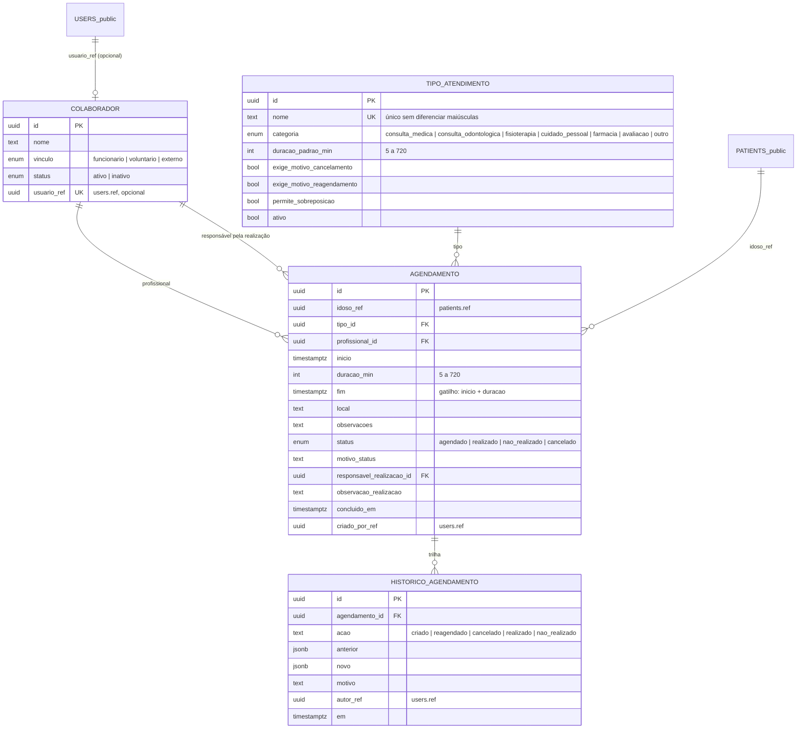

# Grupo 3 — Agenda, atendimentos e profissionais

Backend dos épicos E07 (agenda, cuidados e atendimentos), E08 (fisioterapia), E09 (atendimento médico e odontológico) e E10 parcial (US-091 a US-096).

| Fatia | Escopo | Situação |
|---|---|---|
| 1 | `Colaborador` mínimo, US-065, US-066, US-067, US-068, US-069, US-072, US-073 | **Entregue** |
| 2 | US-070, US-071, US-074 (lembretes + job) | A fazer |
| 3 | US-091, US-092, US-082, US-083, US-084, US-093 | A fazer |
| 4 | US-085 a US-089 | A fazer |
| 5 | US-075 a US-080 | A fazer |
| 6 | US-094 a US-096 + indicadores para o Grupo 5 | A fazer |
| 7 | US-081, US-090 (P2) | A fazer |

As suposições e as decisões pendentes estão em [decisoes-pendentes.md](decisoes-pendentes.md).

## Onde fica cada coisa

| Caminho | Conteúdo |
|---|---|
| `sql/grupo3.sql` | Schema `grupo3`: tabelas, constraints, índices e gatilhos (carregado por `src/db/reset.js`) |
| `src/grupo3/regras.js` | Regras puras: conflito, transições, motivo, LGPD |
| `src/grupo3/agenda.js` | Consultas da agenda, conflito com lock por profissional, histórico |
| `src/grupo3/validacao.js` | Esquemas zod compartilhados |
| `src/grupo3/portas/` | Portas de integração (`idosos.js`, `prontuario.js`) |
| `src/routes/grupo3/` | Rotas, montadas em `/api` por `index.js` |
| `src/docs/openapi.grupo3.js` | OpenAPI do G3, juntado em `src/docs/openapi.js` |
| `src/db/seedGrupo3.js` | Dados de demonstração |
| `tests/grupo3.rules.test.js`, `tests/grupo3.api.test.js` | Testes unitários, de integração e de permissão |

Segue a stack e as convenções do repositório: Express, SQL puro via Prisma (`$queryRaw`), zod, `node:test` + supertest com banco real (`sislar_test`), erro no formato `{ "error": { "message", "details" } }`.

## Modelo de dados (Fatia 1)

Idoso e usuário entram como UUID (`patients.ref`, `users.ref`), no mesmo padrão do Grupo 2, sem FK entre schemas. A API valida esses UUIDs pela porta de integração.

Integridade garantida no banco:

- `fim` é preenchido pelo gatilho `preparar_agendamento`, com `CHECK (fim > inicio)`. Não é coluna gerada porque `timestamptz + interval` é STABLE.
- Agendamento encerrado (realizado, não realizado ou cancelado) não pode ser alterado.
- Agendamento, tipo e colaborador não aceitam `DELETE`: o caminho é cancelar ou inativar.
- `historico_agendamento` não aceita `UPDATE` nem `DELETE`.
- `CHECK`: status diferente de `agendado` ⇔ `concluido_em` preenchido. Realizado ou não realizado exige responsável.
- Índice parcial `(profissional_id, inicio) WHERE status = 'agendado'` para a checagem de conflito.

## Regras de negócio

**Conflito (US-073).** Há conflito quando o mesmo profissional tem outro agendamento `agendado` cujo intervalo `[inicio, fim)` se sobrepõe ao novo. Encostar no fim do anterior não é conflito. Cancelado, realizado e não realizado não conflitam. A sobreposição só é permitida quando o novo e o existente são do **mesmo tipo** e esse tipo tem `permite_sobreposicao = true`; qualquer outra combinação é conflito. A checagem roda dentro da transação, depois de um `pg_advisory_xact_lock` por profissional, então duas gravações simultâneas no mesmo horário não passam juntas. No reagendamento, a checagem ignora o próprio agendamento. Conflito responde `409` com `error.details.conflitos`. `POST /api/agendamentos/verificar-conflitos` faz a mesma checagem sem gravar.

**Status (US-068, US-069).** `agendado → realizado | nao_realizado | cancelado`. Reagendar mantém o mesmo registro e grava `anterior → novo` no histórico. O motivo é obrigatório conforme a configuração do tipo. A realização só pode ser registrada depois do horário de início.

**Agenda (US-066).** Dia, semana (segunda a domingo) ou mês, calculados no fuso da instituição (`grupo3.configuracao.fuso_horario`, padrão `America/Sao_Paulo`). Cada item traz `status` e `emConflito`; o `resumo` conta os itens por status e os em conflito.

**LGPD.** Nas categorias clínicas (consultas, avaliação e fisioterapia), `observacoes`, `motivoStatus` e `observacaoRealizacao` voltam `null`, com `conteudoRestrito: true`, para quem não tem `atendimento-clinico.visualizar` (consultas e avaliação) ou `fisioterapia.visualizar`. A exceção é o próprio profissional do agendamento. A trilha de histórico aplica a mesma regra.

## Endpoints (Fatia 1)

A documentação completa, com exemplos e erros, está em `/api/docs`.

| Método e rota | Permissão | US |
|---|---|---|
| `GET /api/tipos-atendimento` | `agenda.visualizar` | 065 |
| `GET /api/tipos-atendimento/{id}` | `agenda.visualizar` | 065 |
| `POST /api/tipos-atendimento` | `agenda.administrar` | 065 |
| `PUT /api/tipos-atendimento/{id}` | `agenda.administrar` | 065 |
| `PATCH /api/tipos-atendimento/{id}/status` | `agenda.administrar` | 065 |
| `GET /api/colaboradores` · `GET /api/colaboradores/{id}` | `equipe.visualizar`, `agenda.criar` ou `agenda.editar` | — |
| `POST /api/colaboradores` | `equipe.criar` | — |
| `PUT /api/colaboradores/{id}` | `equipe.editar` | — |
| `PATCH /api/colaboradores/{id}/status` | `equipe.excluir` | — |
| `GET /api/agendamentos` | `agenda.visualizar` | 066 |
| `POST /api/agendamentos/verificar-conflitos` | `agenda.criar` ou `agenda.editar` | 073 |
| `POST /api/agendamentos` | `agenda.criar` | 067, 073 |
| `GET /api/agendamentos/{id}` | `agenda.visualizar` ou ser o profissional | 067 |
| `POST /api/agendamentos/{id}/reagendar` | `agenda.editar` | 068, 073 |
| `POST /api/agendamentos/{id}/cancelar` | `agenda.editar` | 068 |
| `POST /api/agendamentos/{id}/realizacao` | `agenda.editar` | 069 |
| `GET /api/agendamentos/{id}/historico` | `agenda.visualizar` ou ser o profissional | 068 |
| `GET /api/colaboradores/{id}/agenda?visao=dia\|semana\|mes&data=` | `agenda.visualizar` | 066 |
| `GET /api/me/agenda?visao=&data=` | sessão autenticada | 066 |
| `GET /api/idosos/{idosoId}/atendimentos` | `agenda.visualizar` | 072 |

Listagens: `page` e `limit` (máx. 100), resposta `{ data, meta }`. Datas com hora em ISO 8601 com fuso (`2026-11-10T14:00:00-03:00`); o banco grava em UTC. `idosoId` é o mesmo id usado no prontuário (ex.: `p02`).

### Rotas legadas (obsoletas)

`GET/POST /api/agenda` (tabela `agenda_events`), `GET/POST /api/atendimentos` (tabela `appointments`) e `GET /api/funcionarios` são do protótipo. Continuam funcionando sem alteração, mas estão marcadas como `deprecated` no OpenAPI. Use `/api/agendamentos`, `/api/idosos/{idosoId}/atendimentos` e `/api/colaboradores`.

## Matriz de permissões

Códigos `<modulo>.<acao>`, adicionados em `src/lib/permissions.js` (arquivo da Fundação, em commit separado). Os códigos `modulo.*` existentes não mudaram. O perfil `admin` tem todos.

| Perfil | agenda | fisioterapia | atendimento-clinico | equipe | tarefas |
|---|---|---|---|---|---|
| gestor | visualizar, criar, editar, excluir, administrar | visualizar, administrar | visualizar, administrar | todas | visualizar, criar, editar, administrar |
| enfermagem | visualizar, criar, editar | visualizar | visualizar | visualizar | visualizar, criar, editar |
| técnico | visualizar | — | — | — | visualizar, editar |
| médico | visualizar, criar, editar | visualizar | visualizar, criar, editar | — | visualizar, editar |
| fisioterapia | visualizar, criar, editar | visualizar, criar, editar | — | — | visualizar, editar |
| odontologia | visualizar, criar, editar | — | visualizar, criar, editar | — | visualizar, editar |
| farmácia | visualizar, criar, editar | — | — | — | visualizar, editar |
| recepção | visualizar, criar, editar | — | — | — | visualizar, editar |
| estoque | — | — | — | — | visualizar, editar |
| voluntário | **só `/api/me/agenda`** | — | — | — | visualizar, editar |

- Cancelar e reagendar exigem `agenda.editar`.
- `excluir` significa inativar (tipos e colaboradores); não existe exclusão física.
- A partir da Fatia 6, `tarefas.editar` só vale para tarefas em que o usuário é o responsável, salvo `tarefas.administrar`.

## Auditoria

Usa a auditoria da Fundação (`public.audit_log`, via `audit()` em `src/db/helpers.js`), que já grava autor, data/hora, ação, entidade e identificador. O resultado vai em `payload.resultado` (`sucesso` ou `recusado_conflito`). O payload não leva texto clínico livre.

| Ação | Quando |
|---|---|
| `tipo_atendimento.criar` · `editar` · `ativar` · `inativar` | Alterações em tipos |
| `colaborador.criar` · `editar` · `ativar` · `inativar` | Alterações em colaboradores |
| `agendamento.criar` · `reagendar` · `cancelar` · `realizado` · `nao_realizado` | Alterações em agendamentos; criar e reagendar também registram recusas por conflito |

## Contratos de integração

| Porta | Arquivo | Situação | Contrato |
|---|---|---|---|
| Idosos (G1, US-011) | `src/grupo3/portas/idosos.js` | Adaptador real sobre `public.patients` | `buscarIdoso(idosoId) → { id, ref, nome, ativo } \| null`; `buscarIdososPorRef(refs) → Map<ref, idoso>`. `ativo` é sempre `true`: `TODO(integracao-G1)` |
| Prontuário — visibilidade (G1, US-031) | `src/grupo3/portas/prontuario.js` | Stub `TODO(integracao-G1)` | `podeVerIdoso(usuario, idoso) → boolean`, chamado no histórico do idoso |
| Prontuário — linha do tempo (G1, US-023/US-030) | `src/grupo3/portas/prontuario.js` | Stub `TODO(integracao-G1)`; uso a partir da Fatia 4 | `publicarNoProntuario({ idosoRef, origem: "grupo3", tipo, referenciaId, ocorridoEm, profissional, resumo }) → { status }` |
| Notificações (G4, US-117) | — | Fatia 2 | Lembrete vira `public.notifications`. Colaborador sem `usuario_ref` gera status `sem_destinatario` |
| Indicadores (G5) | — | Fatia 6 | `GET /api/indicadores/atendimentos \| tarefas \| equipe` |
